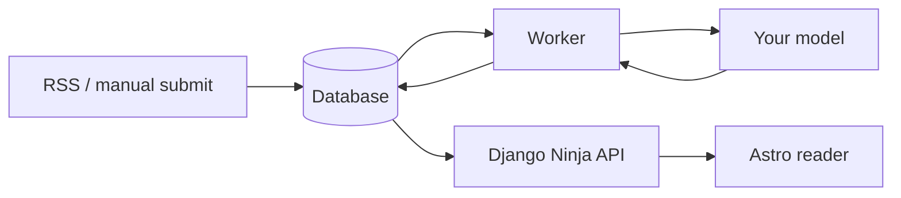

# Architecture

How an article becomes a card, where the code is, and the rules the code keeps. What is verified is in [status.md](status.md).

## Shape

One repository, three processes: the Astro reader (server-rendered), the Django API, and a worker that shares the backend code. One database. The model is an HTTP endpoint you configure.

## The pipeline

| Step | What happens | Code (`backend/src/delta_feed/`) |
|---|---|---|
| 1. Ingest | The worker polls each feed; new entries become an article with an immutable revision. First poll imports recent history only ("backfill"). | `content/rss.py`, `content/use_cases.py` |
| 2. Extract | Job `analysis.extract` sends one revision to the model and stores validated output on an analysis run: entities, claims (predicate, value, scope), verbatim quotes. | `analysis/use_cases.py`, `analysis/contracts/extraction.py`, `analysis/prompts/` |
| 3. Resolve names | Each extracted name is stored as a mention. It resolves by itself only when exactly one entity has that name or alias. Otherwise it waits for review. A link or create can be undone until its comparison job starts (20 seconds by default); a dismiss can be restored at any time. | `application/mention_resolution.py`, `knowledge/api.py` |
| 4. Compare | Job `analysis.compare` (or `analysis.compare_group` after a review) classifies each claim against the entity's active claims and writes it. | `application/claim_comparison.py`, `core/claim_delta.py`, `core/claim_fingerprint.py` |
| 5. Read | `GET /api/reader/delta` returns, per article, the claims that are not duplicates. `GET /api/reader/feed` returns every article. | `reader/api.py` |

### Comparison tiers

1. **First sighting**: the entity has no claims yet, so every claim is new.
2. **Fingerprint**: same entity, predicate, value and scope as an existing claim is a duplicate. No model call.
3. **Lexical rules**: exact text, explicit negation, or a strict superset of words.
4. **Model**: one call for the claims still undecided, given the entity's existing claims. A claim the model cannot place, or an answer that fails a check, is "not sure".

The write happens under a lock on the entity, after rechecking that its claims did not change during the model call.

## Rules the code keeps

- **Models propose, code writes.** Model output is validated against a strict schema; nothing from a model reaches the database unchecked.
- **Article text is data.** Prompts delimit it and tell the model to ignore instructions inside it.
- **Evidence is verbatim.** A quote not found in the analysed text is dropped, and an item with no valid quote is dropped with a recorded reason.
- **Claims are append-only.** A correction is a new claim that points at the old one.
- **No silent duplicates.** A claim is a duplicate only on an exact match or a model answer that names the claim it matches.
- **No model call inside a database transaction.**
- **Backfill never produces cards.** It only adds to the baseline.
- **Fetching is bounded.** Public addresses only, every redirect checked, size and time limits.
- **No fallback provider.** Only the configured model is used.

## Module map

| Module | Owns |
|---|---|
| `accounts` | Sign-in, first-run setup, onboarding state |
| `content` | Sources, articles, revisions, RSS polling |
| `knowledge` | Entities, mentions, claims, topics, starter packs |
| `analysis` | Model providers, prompts, output contracts, analysis runs, scheduling |
| `application` | Use cases that cross modules: name resolution, claim comparison |
| `core` | Pure rules with no Django imports: claim comparison, fingerprints, guide eligibility |
| `guides` | Guides, entries, revisions, proposals |
| `reader` | Feed and Delta endpoints, read and save state |
| `jobs` | Job queue, leases, retries, the `run_worker` command |
| `frontend/src/pages` | Astro pages; `lib/api/` has the server and browser API clients |

Rule of thumb: a rule that must run without Django goes in `core`; everything else stays in its module as ordinary Django ([ADR 0003](decisions/0003-selective-hexagonal-backend.md)).

## Frontend and sign-in

The browser talks to one origin. Astro renders pages on the server and forwards only the session and CSRF cookies to Django. Browser changes go through `/api/*` on the Astro server, which relays them with the CSRF token. Django owns sessions and permissions. Private pages are never cached or pre-built.

## Limits and budgets

| Setting | Default | Effect |
|---|---|---|
| `BACKFILL_DAYS`, `BACKFILL_MAX_ITEMS` | 30, 20 | History imported when a source is added |
| `RSS_POLL_INTERVAL_MINUTES` | 30 | Poll interval; failures back off up to 24 hours |
| `ANALYSIS_DAILY_BUDGET` | 50 | Model runs per day, extraction and comparison together |
| `ANALYSIS_MAX_BODY_CHARS` | 20000 | Longer articles are analysed as a prefix and marked truncated |
| `TODAY_BUDGET`, `TODAY_PER_SOURCE_CAP` | 12, 3 | Cards on the current Today view |

A model outage retries with backoff and does not spend the budget. Invalid output settles the article as failed and stores the reason.

## Stack

| Part | Choice |
|---|---|
| Reader | Astro (server-rendered), TypeScript, plain CSS, no UI framework |
| API and backend | Django with Django Ninja |
| Database | SQLite for development and tests; PostgreSQL required for real use, not yet tested |
| Worker | Django command with database-backed jobs |
| Models | Ollama or any OpenAI-compatible server (LM Studio) |
| Tooling | uv, pytest, Ruff; npm, Vitest |

No platform or version is claimed as supported until it has been tested.
