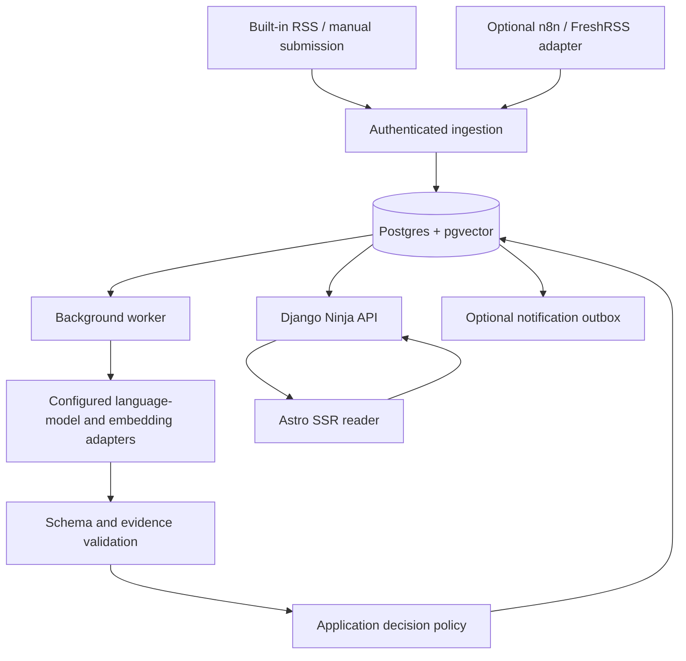

# Architecture

Status: intended design, not implemented API or schema.

Terms follow the [glossary](glossary.md). See [repository structure](repository-structure.md) for the target package layout and module ownership, and [development workflow](development-workflow.md) for implementation/review gates.

## Shape

One product repository: Astro SSR frontend and a Django backend exposing a Django Ninja JSON API. Frontend, API and Python worker are distinct processes; API/worker share backend code and image. Backend modules own ingestion, identity/claims, analysis, reading state and delivery; Astro owns presentation. Keep source/model adapters small. Backend layering follows [ADR 0003](decisions/0003-selective-hexagonal-backend.md); state axes and atomic boundaries are defined in the [content policy](content-policy.md).

## Proposed domain records

- Source, ingestion receipt, article, and immutable article revision.
- Entity, scoped identity key, alias, and topic membership.
- Claim, source evidence, and relationships such as refines/contradicts.
- Event (grouped coverage of one discovery or change) and its reader card, linked to supporting records.
- Reading state and user feedback, separate from global entity existence.
- Guide definitions, contextual entries, protected personal prose, proposed diffs and published revisions.
- Observation ordering/backfill intent and explicit correction audit records.
- Analysis run (prompt/schema/model/index version), job, and notification outbox.

Aliases/names alone are not globally unique identities. Repository/package keys need namespaces and normalization rules. Topic filters must not exclude plausible cross-topic identity candidates.

## Ingestion

All inputs (built-in RSS, manual submission, external collectors) go through one ingestion use case defined by the [ingestion contract](ingestion-contract.md). Collectors submit observations only; they never create sources/topics or submit novelty verdicts.

## Semantic pipeline

1. Extract discrete entities, atomic claims, and source passages into validated structured output.
2. Resolve strong identity keys; retrieve name/vector candidates for uncertain identities.
3. Adjudicate only bounded candidate pairs; unresolved identities remain uncertain.
4. Retrieve relevant baseline claims with version/platform/availability scope.
5. Classify duplicate/novel/refinement/contradiction with evidence; absence from a small top-k set is not proof of novelty.
6. Store validated analysis proposals and recheck baseline state for acceptance. News starts in shadow mode; proposed suppression stays inspectable, no automatic hiding.
7. Accept knowledge/news dispositions atomically where authorized; group corroborating coverage without duplicate events. Guide candidates use a separate editorial approval path, never blocking news acceptance.

The application owns prompts, schemas, policy, and writes. Models only return proposals. Self-reported confidence is not a calibrated probability. Verify evidence passages against supplied content; provenance proves what a source asserted, not that the assertion is objectively true.

Claims retain source/publication/discovery times and scope. Corrections append relationships rather than silently rewriting history. A derived baseline is rebuildable from accepted claims. Lock/recheck entity-scoped state before final writes so concurrent analyses cannot independently publish the same delta; do not hold DB transactions open across model calls.

## Worked example (illustrative)

Fictional names, not retrieved content. It follows one article through the pipeline in shadow mode.

**Before:** you keep a guide, *Raspberry Pi home automation*. One entry recommends **HubCore**, a home-automation hub, with the caveat "Zigbee support is beta (since 2.8)". Another recommends **PiSense**, a sensor firmware. Both entities are therefore familiar and followed, and the baseline holds the claim "HubCore Zigbee support: beta, v2.8".

**Article:** a weekly roundup, "10 Pi projects this week", arrives through built-in RSS.

1. **Ingestion:** the RSS adapter submits an observation; receipt and job are committed; the worker fetches the page and stores an article revision.
2. **Extraction:** the model returns 10 entities and their claims with evidence passages, e.g. "HubCore 3.0 makes Zigbee support generally available" and "SenseLite: open-source BLE sensor firmware for Pi Zero 2". Passages are verified against the stored article text.
3. **Identity:** 8 entities match known ones through strong identity keys (repository/package identifiers). **SenseLite** has no strong key; vector search finds PiSense as a candidate, and adjudication cannot tell whether it is a fork or a rename, so it stays **uncertain**. **GardenPi** has no plausible candidate and becomes a **new** entity.
4. **Claim comparison:** HubCore "Zigbee GA in 3.0" against the baseline "Zigbee beta in 2.8" is a **refinement** with an availability change (beta → GA). The other known entities' claims are **duplicates**.
5. **Reader (shadow mode):**
   - Following: card "HubCore 3.0: Zigbee support now generally available (beta since 2.8)", linked to the roundup passage.
   - Discoveries: card for GardenPi, saying why it is shown.
   - All Content: SenseLite listed as uncertain, showing the PiSense candidate with review actions.
   - The 7 duplicate items get no cards. They are labelled "proposed: already known", not hidden, and the roundup stays readable.
6. **Guide proposals** (separate approval path): "update HubCore entry: remove the 'Zigbee is beta' caveat", with the evidence passage. GardenPi yields an add-entry proposal only if it matches the guide's eligibility criteria; new does not mean recommended. Approving creates a new guide revision; your own introduction and notes are untouched.

## Provider interfaces

- LanguageModel.analyze(task, input, output_schema)
- EmbeddingModel.embed(texts)

Tasks: extract_entities_and_claims, resolve_entity_pair, compare_claims, classify_topics. Adapter capabilities include structured-output and context limits; validate even when a provider claims schema enforcement. Pin embedding model/digest/dimension and analysis prompt/schema version. Re-index explicitly on embedding changes; never compare incompatible vector spaces. No fallback to cloud without explicit privacy/budget approval.

## Frontend/API boundary and authentication

Route the browser through one origin: reading pages to Astro SSR, /api/* and Django-owned auth/admin paths to Django. Standalone Compose needs a generic routing layer, not a specific reverse proxy. Astro renders personalized pages on demand with an adapter (Node runtime initially); do not rebuild news into static private pages.

Django owns login/logout, sessions and authorization. SSR uses a configured backend destination and forwards only allowlisted session context; no internal service credential that impersonates every user. Browser mutations carry CSRF protection; explicitly protect login as well as authenticated mutation endpoints. Do not assume Django middleware alone protects Ninja routes. Verify actual selected-version cookie-auth behavior and use Django Client(enforce_csrf_checks=True) plus browser tests. Cookie paths, trusted origin, secure flags, redirects, auth bootstrap and expiry behavior must be exercised end-to-end; no JWT in localStorage by default. A perimeter authentication proxy may add protection in front of the app but never replaces application permissions.

Ninja API schemas are the authoritative external contract; analysis result schemas remain separate. Generate TypeScript types from OpenAPI using a chosen locked tool (openapi-typescript candidate), while a small frontend client handles fetch/errors/session. Frontend never accesses the database or applies publication policy. Private HTML and personalized responses must not be shared-cacheable; do not expose secrets in hydrated island props. Small browser scripts/islands implement local interaction; no mandatory React or HTMX layer.

## Jobs and recovery

Use durable jobs with pending/leased/succeeded/failed states, lease expiry, bounded attempts, backoff, inspectable errors, and manual retry. Claim jobs transactionally (e.g. SKIP LOCKED); expired leases are recoverable after restart. External calls are outside transactions; writes are idempotent. Serialize or revalidate same-entity publication decisions.

Index lag/unavailability, incomplete extraction, malformed output, and inference timeouts defer semantic decisions rather than declaring everything new or suppressing it. Obtained original content remains readable where retained; failed URL-only fetches expose metadata/error without pretending a body was obtained. Exact matching can proceed where safe.

Outbox entries are created with domain changes, then delivered separately. Record attempts/provider handles. External delivery is generally at-least-once, not magically exactly-once; use recipient idempotency where available and acknowledge residual duplicate risk. Only one notification owner per integration.

## Safety

- Treat source text as hostile data, never instructions; no shell/tool/browser authority for analysis tasks.
- Prevent SSRF: public fetch targets only by default, check resolved addresses and redirects, reject private/loopback/link-local/metadata destinations, bound bytes/time/redirects. Test DNS/rebinding behavior; do not rely on URL string checks alone.
- Sanitize rendered content, escape model/source text, use authenticated sessions, CSRF protection, secure cookies, and rate limits for submission/login.
- Redact credentials and avoid logging full sensitive content. Secrets remain runtime configuration, not committed files.
- Respect access restrictions and source terms; no paywall bypass or arbitrary full-text redistribution.

## Deployment and operations

Standalone: Astro SSR + Django Ninja API + Python worker + dedicated database, with configured inference endpoint and a generic same-origin routing layer. Host-specific placement and private ingress configuration belong in the installer's infrastructure repository, not this public product repository. This is not a deployment authorization.

Operational acceptance includes readiness/health endpoints, processing backlog/failure metrics, model cost/latency and queue age, migrations, database logical backup plus retained content policy, and a restore test. Cached reader content should remain available during inference outages. No infrastructure changes belong in this documentation-only milestone.
